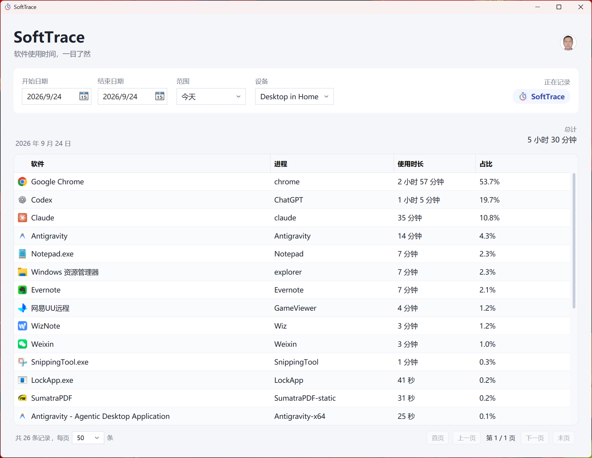

<p align="center">
  
</p>

<h1 align="center">Soft Trace</h1>

<p align="center"><strong>本地记录软件使用时间，清晰查看每日排行与使用习惯。</strong></p>

<p align="center">
  <a href="https://github.com/yuzhounh/soft-trace/releases/latest"></a>
  <a href="LICENSE"></a>
  
  
</p>

<p align="center">
  <a href="https://github.com/yuzhounh/soft-trace/releases/latest">下载发布版</a> · <a href="#开发与验证">快速开始</a> · <a href="LICENSE">开源协议</a>
</p>

Soft Trace 是一个轻量级 Windows 软件使用时间追踪工具。它在本地记录当前前台软件，并按日期汇总使用时长。

<p align="center">
  
</p>

## 功能特点

日常0.8.4保留现有功能和数据，正常同步仍为每分钟；临时失败按约2、4、8至最多15分钟退避并带抖动，网络恢复或手动同步立即重试，成功后恢复一分钟。启动同步纳入可取消/等待的后台循环，退出时释放网络监听。日常完整包使用原本机数据目录，旧采集进程退出后才切换入口；源码/构建、待激活和实际运行版本分别登记在维护中心，不将已构建称为已安装。仅本地可信构建的切换助手检查路径、版本及必需文件，不追加下载/复制的哈希比较。

以下为当前 v0.8.0 功能：多日视图按实际范围提供 24 小时分布、星期规律及学期与寒暑假对比，月份分组采用寒假 2 月、暑假 7–8 月、春季学期 3–6 月和秋季学期 9 月至次年 1 月。统一各视图的软件用时，提供环形图和占比条布局、完整分页列表，以及昨天、近 7/30 天、近一季度/一年和自定义范围。活动时间轴支持拖选放大、筛选逐段明细、恢复全天和点击双向定位，选区不改变当天概况及软件总用时。托盘移除“账号、同步与数据管理”，管理功能保留在网页设置中；延续 v0.6.1 的退出修复和原有同步功能。完整本地包按退出再切换策略更新日常入口，运行状态以实际进程和更新回执为准。下载区仍指向此前的 v0.3.4 公开发布包。使用方式与刷新生效的资源目录见 [本地网页与每日记录](docs/local-dashboard.md)，旧窗口设计见 [历史 WPF 使用记录表格列宽](docs/usage-table-layout.md)。

- 自动识别当前前台软件和窗口标题，不采集键盘内容、网页正文或浏览器 URL
- 从可执行文件提取软件图标，以紧凑排行显示
- 原创彩色秒表应用图标，并内置多种 Windows 显示尺寸
- 1 秒轮询，软件切换或窗口标题变化时生成活动区间
- 默认连续空闲 3 分钟停止计时；空闲、锁屏、睡眠、暂停和无法采集分别保存状态区间
- 本地托盘持续采集，浏览器展示每日概况、状态/软件时间轴、逐段明细与软件排行；关闭网页后继续记录
- 网页资源为独立文件，界面修改后刷新即可生效；本项目日常程序直接读取 `src/SoftTrace.App/Web/`，独立安装使用 EXE 旁的 `Web/`
- 支持按设备和日期查询、软件筛选、标题搜索、时间定位、明细分页与明暗主题
- SQLite 本地持久化，使用 UTC、WAL 和 15 秒检查点
- 今天、近 7 天、近 30 天或自定义日期范围的软件使用排行
- 系统托盘常驻、暂停/继续记录、单实例运行
- 异常退出后按最后检查点自动封闭未完成区间
- 采集写入失败时暂停并显示错误，可从托盘继续记录；故障空档不会补计时
- 使用系统浏览器完成 Google 登录，采用 OAuth 2.0 PKCE
- Firebase Firestore 每分钟自动双向同步，启动与登录后立即同步
- 每台电脑使用稳定设备 ID，可查看全部设备或单台设备统计
- 设备显示名称在同一账号的设备间同步，改名不改变实际设备名、设备 ID 或历史记录归属
- 同步区间使用稳定 `sync_id` 去重，重复拉取不会重复累计
- Firebase 刷新令牌使用当前 Windows 用户的 DPAPI 加密保存
- 可直接导入 ManicTime 备份 ZIP 或 `ManicTimeReports.db`
- 导入时合并同一应用的连续记录，并只填补 Soft Trace 尚未覆盖的时间

## 下载

从 [GitHub Releases](https://github.com/yuzhounh/soft-trace/releases) 下载 Windows x64 版本：

- `SoftTrace-v0.3.4-win-x64-Setup.exe`：推荐普通用户使用的安装版，提供开始菜单快捷方式、可选桌面快捷方式和标准卸载入口。
- `SoftTrace-v0.3.4-win-x64-Portable.zip`：绿色便携版，ZIP 内只有 `SoftTrace.exe`，解压后无需安装即可运行。

`v0.3.4` 增加设备显示名称同步：改名后立即尝试上传，其他已登录同一账号的设备在下一次同步后更新显示；离线改名自动保留并在联网后重试。名称单独保存，不改写 Windows 实际设备名、设备 ID 或历史使用记录。多台设备同时改名时，以最后成功写入云端的名称为准。旧版别名会迁移；云端已有名称时优先采用云端值。保留 v0.3.3 的内置 Google 登录配置和便携 ZIP。升级时先从托盘退出旧版，再安装或替换程序；保留原有本地数据库和设置，无需卸载或删除数据。

两个版本均为 Windows x64 自包含程序，不要求另行安装 .NET。关闭主窗口只会隐藏到系统托盘；需要彻底退出时，请右键托盘图标并选择“退出”。卸载安装版时默认保留本地使用记录，也可在卸载提示中选择一并删除。

数据库与运行日志保存在：

```text
%LOCALAPPDATA%\SoftTrace\softtrace.db
%LOCALAPPDATA%\SoftTrace\softtrace.log
%LOCALAPPDATA%\SoftTrace\firebase-sync.json
```

SQLite 始终是本机采集的权威副本；断网期间继续记录，联网后自动补传。`firebase-sync.json` 只保存账号信息和经 DPAPI 加密的 Firebase 刷新令牌，不保存 Google 密码。

若主窗口显示“记录失败，已暂停”，将鼠标移到状态文字可查看原因，完整错误写入 `softtrace.log`。解决问题后，右键托盘选择“继续记录”。仍无法写入时会保持暂停；成功恢复时，旧区间按最后已保存的检查点封闭，从新的观察重新计时。

## 导入 ManicTime 历史数据

点击主窗口右上角的“导入 ManicTime”，选择 ManicTime 生成的备份 ZIP 或解压后的 `ManicTimeReports.db`。导入记录归到当前电脑，并参与正常的本地统计与云同步。

Soft Trace 数据优先：导入器会从每条 ManicTime 活动中扣除当前电脑已有记录覆盖的时间，完全重叠的记录跳过，部分重叠的记录只保留未覆盖部分。导入 ID 是稳定的，因此重复选择同一备份不会重复累计。

## 开发与验证

```powershell
git clone https://github.com/yuzhounh/soft-trace.git
cd soft-trace
.\run.ps1
.\build.ps1
```

`run.ps1` 使用系统级 .NET 10 SDK 启动开发版；`build.ps1` 会运行 Release 构建、核心与采集恢复测试，并生成自包含便携版与 Inno Setup 安装包。构建或测试失败会停止打包。构建安装包需要 Inno Setup 6。

Google 桌面 OAuth 客户端配置在构建时作为资源嵌入程序。开发者须提供 `.tools/firebase-oauth-secret.txt` 中的桌面客户端值；`build.ps1` 也可从当前 Windows 用户已有的 `SoftTrace/firebase-oauth-secret.txt` 配置自动迁移。此构建输入不纳入 Git，不能使用用户刷新令牌或服务账号密钥替代。发布构建缺少配置时会停止；最终用户无需该文件，登录令牌继续使用 DPAPI 加密保存。

## 当前边界

当前源码通过本地网页提供每日时间轴、逐段明细、状态与软件排行、跨日期范围统计、Google 登录与同步管理、设备命名、ManicTime 导入、JSON 导入导出及开机/空闲设置。托盘保留常驻采集和网页入口，旧 WPF 主窗口已在完整备份后移除。暂不包含 CSV 导出、网站域名统计或 Time Lens 数据接入。

## 相关项目

- [timelens-chrome-extension](https://github.com/yuzhounh/timelens-chrome-extension)：统计浏览器中的网站访问时间，可与软件使用统计互补。
- [focus-pace](https://github.com/yuzhounh/focus-pace)：管理专注与休息节奏的 Windows 工具。

## 开源协议

本项目采用 [MIT 许可证](LICENSE)。
